# Introdução

- **Nome:** Gustavo Brasil
- **RA:** 252212
- **Disciplina:** AS406TSN2 - UX/UI e Testes de Software
- **Repositório Público:** https://github.com/brasil1812/testes-caixa-cinza-supabase-gustavo-brasil

Nesta atividade prática individual, realizei uma bateria de testes de caixa cinza em uma API REST de autenticação fornecida pelo Supabase, utilizando o Postman Desktop no Windows (PowerShell) sem camada de interface gráfica (front-end). A proposta de trabalhar em caixa cinza consiste em testar os endpoints da aplicação tendo conhecimento prévio da arquitetura interna da comunicação — como o formato exigido pelo GoTrue/Supabase Auth na rota de concessão de token, cabeçalhos de autorização, variáveis de ambiente e estrutura esperada do payload JSON — enquanto valido o comportamento externo das respostas HTTP diante de entradas válidas e inválidas. Nesta etapa do trabalho, o ambiente do Supabase já foi integralmente configurado com projeto, provedor de e-mail, usuário de teste e chaves públicas prontas para a execução no Postman.

# Objetivo da Atividade

Meu objetivo nesta atividade foi configurar um serviço real de autenticação por e-mail e senha no Supabase e validar o endpoint de login via API (`POST /auth/v1/token?grant_type=password`) por meio de cinco cenários de teste estruturados no Postman. Em cada cenário, busquei inspecionar o código de status HTTP retornado, a estrutura do corpo JSON da resposta, a emissão e armazenamento do token JWT (`access_token`) em autenticações legítimas e o tratamento adequado de erros de validação e de credenciais incorretas quando os dados fogem do esperado.

# Configuração do Supabase

Configurei o projeto no Supabase com o objetivo de disponibilizar um ambiente real de autenticação via Supabase Auth (e-mail e senha), permitindo executar os testes de caixa cinza diretamente pelos endpoints da API no Postman sem depender de front-end.

### Projeto criado e Painel do Supabase

Criei o projeto **`auth-teste-gustavo-brasil`** dentro da organização **`Gustavo Brasil`** (plano Free), operando na branch `main` (ambiente `Production`) e alocado na região **`East US (North Virginia) — us-east-1`** (instância `Nano`, status `Healthy`). No painel principal (**Project Overview**), ficam centralizados o status de saúde do banco de dados primário, a **Project URL** (`https://fvkvnzlhebmwopucgicb.supabase.co`) e os atalhos de conexão da API (**Get connected**).

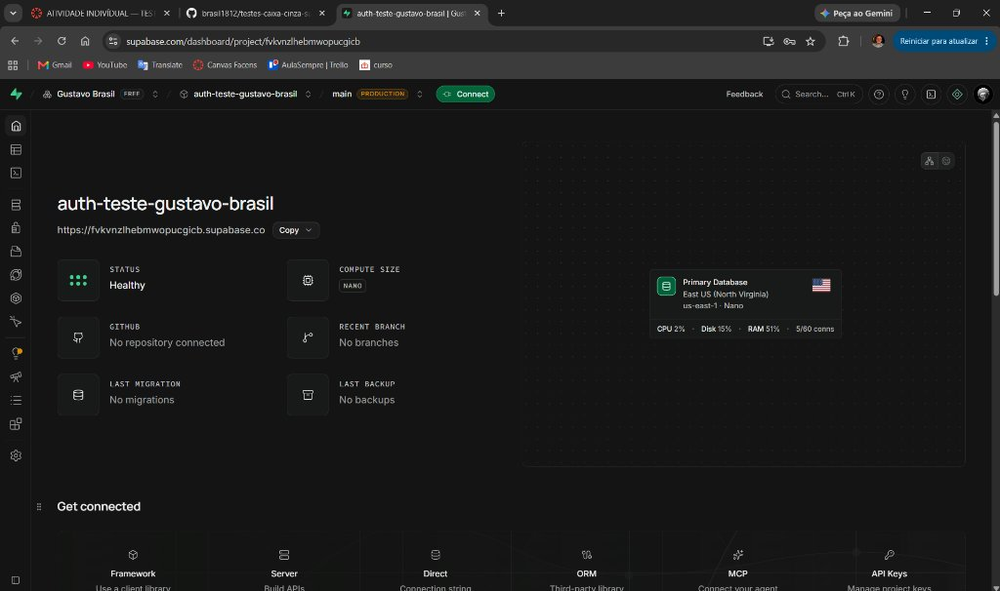
*O print acima evidencia o projeto `auth-teste-gustavo-brasil` criado e ativo (`Healthy`) na organização `Gustavo Brasil`, exibindo a URL base da API (`https://fvkvnzlhebmwopucgicb.supabase.co`) e a alocação na região `East US (North Virginia) / us-east-1`.*

### Autenticação por e-mail

Utilizei o mecanismo de autenticação por e-mail e senha do **Supabase Auth**. Para que os testes de login via API funcionassem diretamente sem exigir clique em link de verificação, acessei **Authentication > Sign In / Providers**, confirmei que o provedor **Email** estava habilitado (`ENABLED`), desativei a opção **Confirm email** e salvei a alteração.

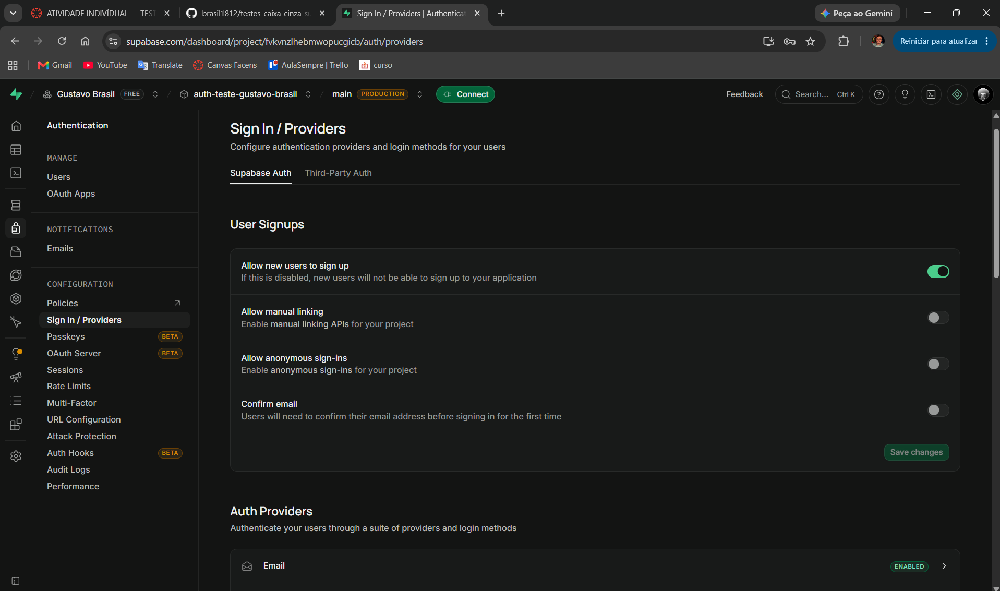
*O print acima mostra a tela Authentication > Sign In / Providers do projeto `auth-teste-gustavo-brasil`, evidenciando o provedor Email como `ENABLED` e a opção `Confirm email` desativada.*

### Usuário de teste

Em **Authentication > Users > Add user > Create new user**, cadastrei o usuário de teste **`gustavoteste@gmail.com`** (`UID: 952b8767-c931-46a0-82d9-e935b0e563ee`) com senha definida e mantive a opção **Auto confirm user** marcada, de modo que nenhum e-mail de confirmação precisou ser enviado e a conta ficou imediatamente ativa. Como cadastrei apenas um usuário, utilizarei esse mesmo e-mail de teste cadastrado para o cenário de login válido, enquanto os cenários de erro usam entradas que não dependem de outros cadastros no banco.

> **Observação sobre o painel:** O rodapé da listagem exibe `Total: 10 users (estimated)`, embora a tabela contenha apenas 1 usuário cadastrado, tratando-se apenas de um contador estimado do próprio painel do Supabase.

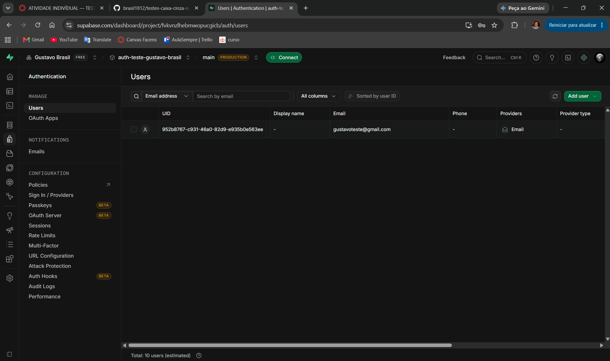
*O print acima exibe a tela Authentication > Users com o único usuário de teste cadastrado (`gustavoteste@gmail.com`) e confirmado, além do rodapé com o contador estimado do painel.*

### Credenciais da API

Em **Project Settings > API Keys** (também acessível pelo botão **Connect**), obtive a **Project URL** (`https://fvkvnzlhebmwopucgicb.supabase.co`) e a chave pública **publishable** (`sb_publishable_0u28JHxYq0n_Or154ucTqg_AjRh1...`), em uma tela que já informa que as chaves legadas (`anon`) serão desativadas no início de 2027. Por segurança, nunca utilizei a chave `secret` nem a `service_role`; nos testes do Postman usarei a chave `publishable` e, caso o Supabase rejeite o header `Authorization: Bearer` com ela durante a execução, farei a troca pela chave `anon` legada e registrarei essa ocorrência na seção de testes.

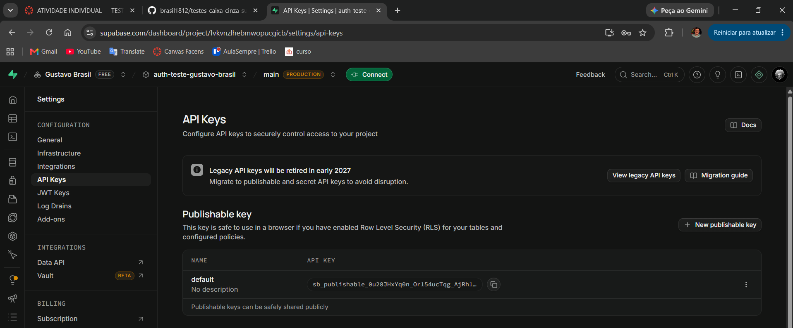
*O print acima mostra a página Project Settings > API Keys do projeto `auth-teste-gustavo-brasil`, exibindo apenas a chave pública `publishable` (`sb_publishable_...`) sem expor chaves secretas.*

### Identificação do aluno no ambiente

Em todas as capturas de tela do Supabase, a barra superior exibe de forma visível a organização **`Gustavo Brasil`** ao lado do projeto **`auth-teste-gustavo-brasil`** (`Production` / `main`), comprovando a autoria e a minha identificação no ambiente configurado.

# Configuração do Postman

Para executar os testes de caixa cinza na API do Supabase, instalei o **Postman Desktop** (Windows 64-bit) e estruturei o ambiente de trabalho da seguinte forma:

- **Como o Workspace foi criado:** Criei e configurei o Workspace **`Brasil's Workspace`**, dedicado a centralizar a coleção de requisições HTTP e o ambiente de variáveis desta atividade.
- **Como o Environment foi configurado:** Na aba **Environments**, criei/importei o ambiente **`Supabase - Gustavo Brasil`** e o selecionei como ambiente ativo no seletor superior direito do Postman.
- **Qual a finalidade das variáveis:** As variáveis de ambiente permitem parametrizar a URL base, a chave da API e as credenciais de acesso sem precisar repetir ou expor valores fixos (*hardcoded*) em cada requisição:

| Variável | Descrição | Valor Configurado no Ambiente |
| :--- | :--- | :--- |
| `base_url` | URL da API do Supabase | `https://fvkvnzlhebmwopucgicb.supabase.co` |
| `api_key` | API KEY pública (`publishable`) | `sb_publishable_0u28JHxYq0n_Or154ucTqg_AjRh1S7o` |
| `email` | Usuário criado no Supabase | `gustavoteste@gmail.com` |
| `password` | Senha criada para o usuário | `••••••••` (tipo `secret`) |
| `access_token` | Token JWT retornado no login válido | Preenchido automaticamente pelo script do `CT01` |

- **Como o Postman será utilizado nos testes:** O Postman Desktop é utilizado para disparar requisições `POST` diretamente ao endpoint `/auth/v1/token?grant_type=password`, inspecionar o código de status HTTP, validar o payload JSON de resposta e executar scripts automatizados (`pm.test`) na aba **Scripts (Post-response)** para verificar cada um dos 5 cenários de caixa cinza. Antes de exportar o arquivo `postman/environment.json` para o GitHub, mantive os valores sensíveis mascarados com `XXXXX`.

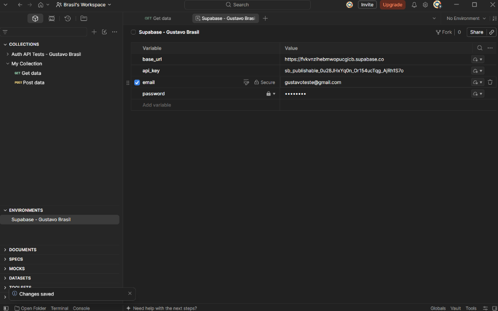
*O print acima mostra o Postman Desktop com o Workspace `Brasil's Workspace`, a coleção `Auth API Tests - Gustavo Brasil` e o Environment `Supabase - Gustavo Brasil` configurado com as variáveis `base_url`, `api_key`, `email` e `password`.*

# Configuração das Requisições

Todas as cinco requisições da coleção **`Auth API Tests - Gustavo Brasil`** foram criadas apontando para o endpoint oficial de autenticação por senha do Supabase Auth (GoTrue):

- **Endpoint utilizado:** `/auth/v1/token?grant_type=password` (URL completa: `{{base_url}}/auth/v1/token?grant_type=password`)
- **Método HTTP utilizado:** `POST`
- **Finalidade da requisição:** Enviar as credenciais do usuário (`email` e `password`) no corpo da requisição em formato JSON para que o servidor de autenticação valide a identidade no banco de dados e, em caso de sucesso, emita um token de acesso JWT (`access_token`) e um `refresh_token`.

### Exemplo de Header

| Header | Valor | Finalidade |
| :--- | :--- | :--- |
| `apikey` | `XXXXX` (`{{api_key}}`) | Identifica o projeto no API Gateway do Supabase |
| `Authorization` | `Bearer XXXXX` (`Bearer {{api_key}}`) | Autoriza a chamada ao serviço Supabase Auth |
| `Content-Type` | `application/json` | Define que o corpo da requisição está no formato JSON |

### Exemplo do Body JSON

Estrutura parametrizada com variáveis do Environment no Postman:
```json
{
  "email": "{{email}}",
  "password": "{{password}}"
}
```

Exemplo literal da estrutura JSON enviada:
```json
{
  "email": "usuario@email.com",
  "password": "123456"
}
```

### Cenários Configurados na Coleção

1. **CT01 Requisição 1 – Login Válido:** utiliza `{{email}}` e `{{password}}` válidos do Environment. O script `pm.test` verifica o status HTTP `200`, confirma a presença da propriedade `access_token` no JSON e grava seu valor na variável `access_token`.
2. **CT02 Requisição 2 – Senha Incorreta:** mantém `{{email}}` válido e envia uma senha incorreta (`"SenhaErrada!999"`). O script valida o retorno de status na faixa `4xx` e a existência de campos de erro no JSON (`msg`, `error_code` ou `error_description`).
3. **CT03 Requisição 3 – Usuário Inexistente:** envia um e-mail com formato válido que não consta na base (`"naoexiste.gustavo.brasil@exemplo.com"`) junto com `{{password}}`. O script valida status `4xx` e estrutura de erro.
4. **CT04 Requisição 4 – Campos Vazios:** envia `email` e `password` como strings vazias (`""`). O script valida status `4xx` e resposta de erro de validação/autenticação.
5. **CT05 Requisição 5 – Credenciais Inválidas:** envia um e-mail malformado sem o caractere `@` (`"emailsemarroba.com"`) e uma senha curta (`"123"`). O script valida status `4xx` e presença de mensagem de erro.

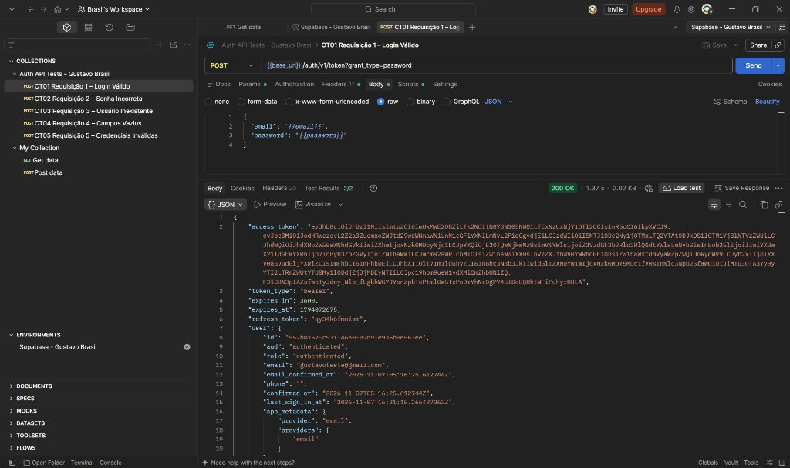
*O print acima evidencia a requisição criada na coleção `Auth API Tests - Gustavo Brasil` no Postman, destacando o método `POST`, o endpoint `{{base_url}}/auth/v1/token?grant_type=password`, os cabeçalhos (`Headers`) e o `Body` em formato `raw / JSON`.*

# Execução dos Testes

Com o Environment **`Supabase - Gustavo Brasil`** selecionado no canto superior direito do Postman, executei cada um dos cinco cenários obrigatórios de caixa cinza para inspecionar o código de status HTTP, o tempo de resposta, o corpo JSON retornado pela API, a emissão do `access_token` e a aba **Test Results** (`2/2` em todos os cenários).

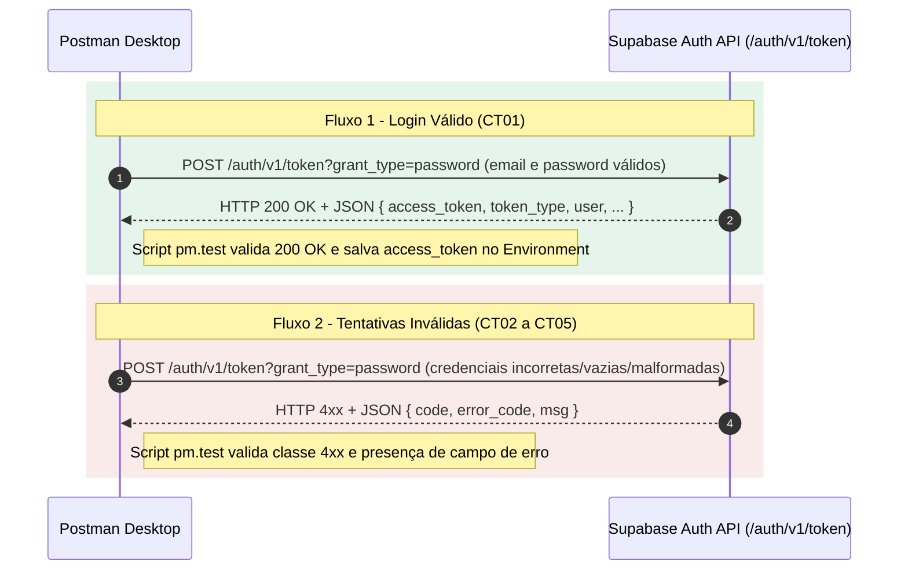

### Tabela de Cenários

| Cenário | Entrada Utilizada | Resultado Esperado | Resultado Obtido | Status |
| :--- | :--- | :--- | :--- | :--- |
| **Login válido (`CT01`)** | `email`: `gustavoteste@gmail.com`<br>`password`: senha correta (`{{password}}`) | Status 200 + `access_token` | Status `200 OK` (1.37 s) + `access_token` JWT e objeto `user` retornados | **OK** |
| **Senha incorreta (`CT02`)** | `email`: `gustavoteste@gmail.com`<br>`password`: `"SenhaErrada!999"` | Erro de autenticação | Status `400 Bad Request` + `{"code": 400, "error_code": "invalid_credentials", "msg": "Invalid login credentials"}` | **OK** |
| **Usuário inexistente (`CT03`)** | `email`: `"naoexiste.gustavo.brasil@exemplo.com"`<br>`password`: `{{password}}` | Acesso negado | Status `400 Bad Request` + `{"code": 400, "error_code": "invalid_credentials", "msg": "Invalid login credentials"}` | **OK** |
| **Campos vazios (`CT04`)** | `email`: `""`<br>`password`: `""` | Erro de validação | Status `400 Bad Request` + `{"code": 400, "error_code": "validation_failed", "msg": "missing email or phone"}` | **OK** |
| **Credenciais inválidas (`CT05`)** | `email`: `"emailsemarroba.com"`<br>`password`: `"123"` | Mensagem de erro | Status `400 Bad Request` + `{"code": 400, "error_code": "invalid_credentials", "msg": "Invalid login credentials"}` | **OK** |

### Evidências de Execução

#### CT01 — Login Válido (`200 OK`)

*Execução do cenário CT01 exibindo status `200 OK` (1.37 s), `Test Results 2/2` aprovados e corpo JSON contendo `access_token`, `refresh_token` e os dados do usuário `gustavoteste@gmail.com`.*

#### CT02 — Senha Incorreta (`400 Bad Request`)
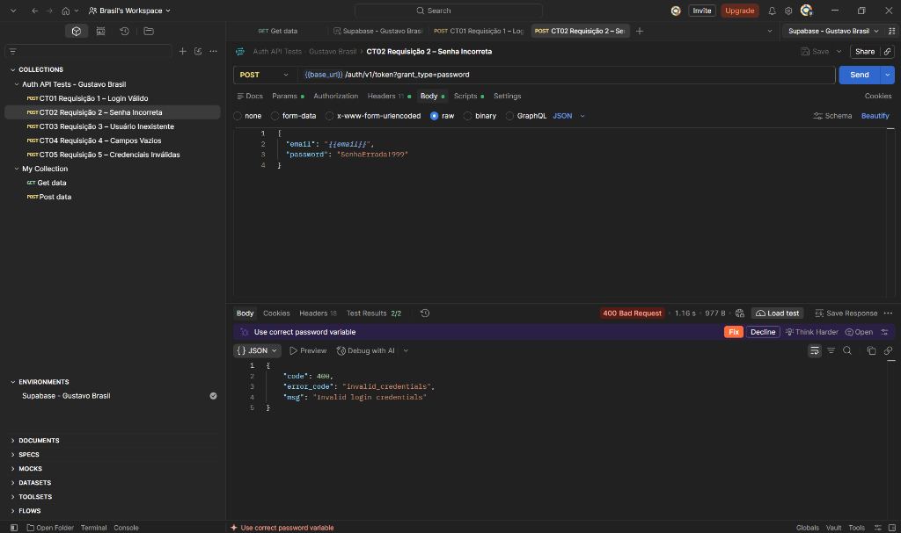
*Execução do cenário CT02 exibindo status `400 Bad Request` (1.16 s), `Test Results 2/2` aprovados e JSON `{"code": 400, "error_code": "invalid_credentials", "msg": "Invalid login credentials"}`.*

#### CT03 — Usuário Inexistente (`400 Bad Request`)
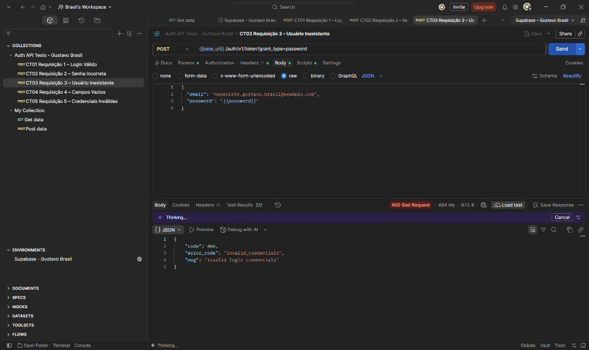
*Execução do cenário CT03 exibindo status `400 Bad Request` (484 ms), `Test Results 2/2` aprovados e JSON `{"code": 400, "error_code": "invalid_credentials", "msg": "Invalid login credentials"}`.*

#### CT04 — Campos Vazios (`400 Bad Request`)
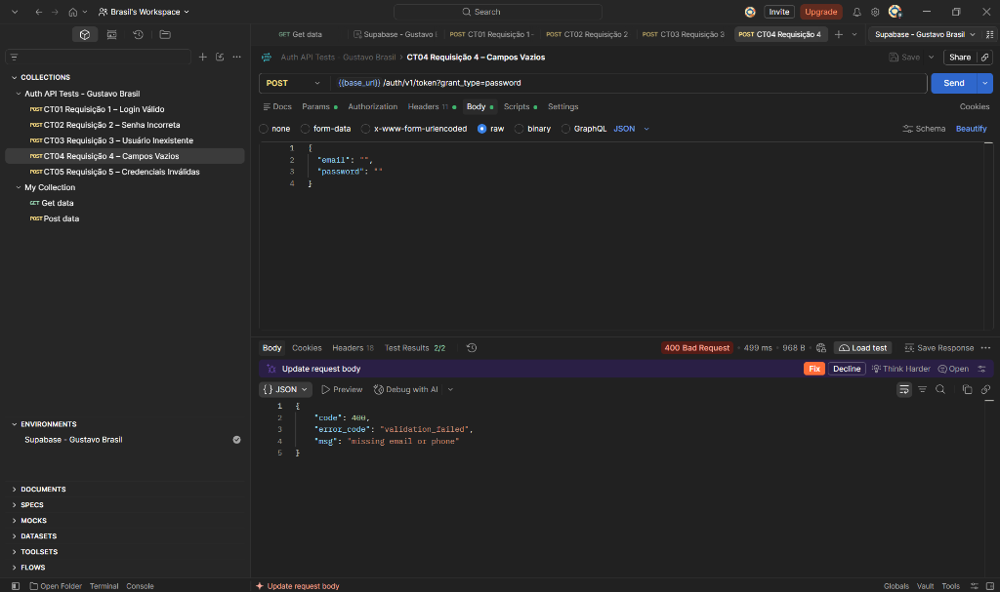
*Execução do cenário CT04 exibindo status `400 Bad Request` (499 ms), `Test Results 2/2` aprovados e JSON `{"code": 400, "error_code": "validation_failed", "msg": "missing email or phone"}`.*

#### CT05 — Credenciais Inválidas (`400 Bad Request`)
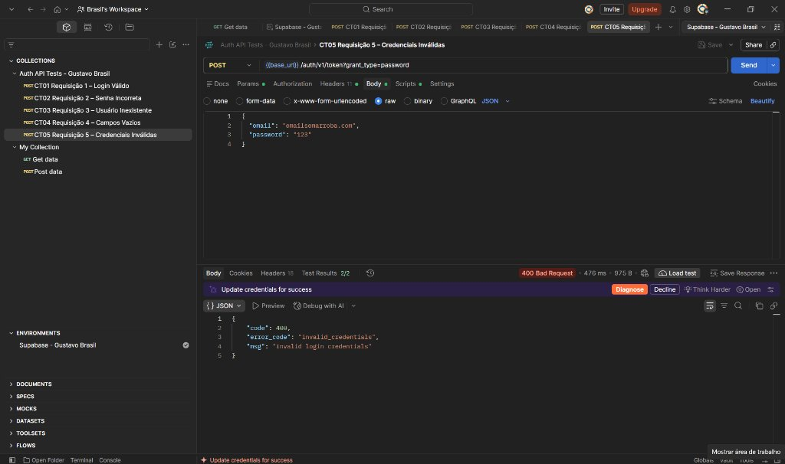
*Execução do cenário CT05 exibindo status `400 Bad Request` (476 ms), `Test Results 2/2` aprovados e JSON `{"code": 400, "error_code": "invalid_credentials", "msg": "Invalid login credentials"}`.*

# Registro dos Testes

- **Como os testes foram registrados:** Os resultados obtidos durante a execução no Postman foram consolidados na planilha oficial `planilha/planilha-testes-caixa-cinza-gustavo-brasil.xlsx`, dividida em três abas conforme o modelo da disciplina: **Informações do projeto** (identificação do responsável, ambiente e contadores automáticos), **Sistema** (casos de teste `CT01` a `CT05` no nível de componente/API) e **Aceitação** (validação dos requisitos funcionais de permitir login válido e bloquear credenciais inválidas).
- **Importância da documentação dos testes:** A documentação estruturada em planilha e no repositório assegura rastreabilidade completa entre cada requisito, a massa de dados de entrada, o retorno real da API e sua respectiva evidência visual (`prints/`). Isso permite reproduzir os testes a qualquer momento e auditar se futuras alterações na API quebram contratos JSON ou regras de segurança.
- **Falhas ou comportamentos identificados nos registros:** Nenhuma falha funcional foi encontrada (todos os 5 casos de teste obtiveram status `Sucesso`). Como observação técnica registrada na planilha, identificou-se que a API utiliza o código `400 Bad Request` tanto para erros de validação de campos vazios (`validation_failed` no `CT04`) quanto para credenciais incorretas (`invalid_credentials` nos cenários `CT02`, `CT03` e `CT05`), mantendo a mensagem `"Invalid login credentials"` padronizada para evitar enumeração de usuários.

### Exemplos dos Registros Realizados (Aba `Sistema`)

| ID do teste | Cenário | Entrada | Resultado esperado | Resultado obtido | Status | Observações |
| :--- | :--- | :--- | :--- | :--- | :--- | :--- |
| **CT01** | Login válido (Requisição 1 - Login Válido) | E-mail (`gustavoteste@gmail.com`) e senha válida do usuário criado no Supabase (Environment) | Status 200 + `access_token` no JSON | `200 OK` (1.37 s) + JSON contendo `access_token` JWT, `refresh_token` e objeto `user` (`gustavoteste@gmail.com`) | **Sucesso** | Print: `prints/06-ct01-login-valido.png`. Variável `access_token` salva no Environment (`Test Results 2/2`). |
| **CT02** | Senha incorreta (Requisição 2 - Senha Incorreta) | E-mail do usuário criado (`gustavoteste@gmail.com`) + senha errada (`"SenhaErrada!999"`) | Status 4xx com erro de autenticação; sem `access_token` | `400 Bad Request` (1.16 s) + JSON `{"code": 400, "error_code": "invalid_credentials", "msg": "Invalid login credentials"}` | **Sucesso** | Print: `prints/07-ct02-senha-incorreta.png`. Acesso negado sem emissão de token (`Test Results 2/2`). |
| **CT03** | Usuário inexistente (Requisição 3 - Usuário Inexistente) | E-mail não cadastrado (`"naoexiste.gustavo.brasil@exemplo.com"`) + senha | Status 4xx com acesso negado; sem `access_token` | `400 Bad Request` (484 ms) + JSON `{"code": 400, "error_code": "invalid_credentials", "msg": "Invalid login credentials"}` | **Sucesso** | Print: `prints/08-ct03-usuario-inexistente.png`. Mensagem genérica que evita enumeração de contas (`Test Results 2/2`). |
| **CT04** | Campos vazios (Requisição 4 - Campos Vazios) | `email: ""` e `password: ""` | Status 4xx com erro de validação | `400 Bad Request` (499 ms) + JSON `{"code": 400, "error_code": "validation_failed", "msg": "missing email or phone"}` | **Sucesso** | Print: `prints/09-ct04-campos-vazios.png`. Erro de validação de campos obrigatórios vazios (`Test Results 2/2`). |
| **CT05** | Credenciais inválidas (Requisição 5 - Credenciais Inválidas) | E-mail malformado (`"emailsemarroba.com"`) e senha curta (`"123"`) | Status 4xx com mensagem de erro | `400 Bad Request` (476 ms) + JSON `{"code": 400, "error_code": "invalid_credentials", "msg": "Invalid login credentials"}` | **Sucesso** | Print: `prints/10-ct05-credenciais-invalidas.png`. Rejeição das credenciais malformadas (`Test Results 2/2`). |

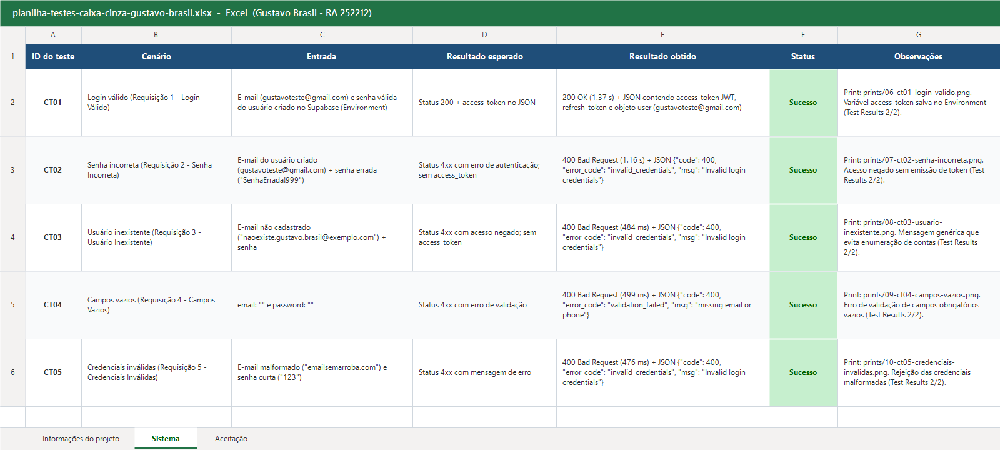
*Visualização da aba `Sistema` da planilha `planilha/planilha-testes-caixa-cinza-gustavo-brasil.xlsx` devidamente preenchida com os cinco cenários (`CT01` a `CT05`), entradas, resultados obtidos, status (`Sucesso`) e observações.*

# Resultados Obtidos

- **CT01 (Login Válido):** A API respondeu com status `200 OK` em `1.37 s` (`2.02 KB`), emitindo um `access_token` JWT assinado com algoritmo `ES256`, `token_type: "bearer"`, `expires_in: 3600`, `refresh_token: "qy34k6fmnisr"` e o objeto `user` completo (`id: "952b8767-c931-46a0-82d9-e935b0e563ee"`, `email: "gustavoteste@gmail.com"`, `role: "authenticated"`). Os dois testes automatizados (`2/2`) passaram e gravaram o token no Environment.
- **CT02 (Senha Incorreta):** Ao informar o e-mail válido com a senha incorreta `"SenhaErrada!999"`, a API negou o acesso retornando `400 Bad Request` em `1.16 s` com o payload `{"code": 400, "error_code": "invalid_credentials", "msg": "Invalid login credentials"}`, sem emitir `access_token` (`Test Results 2/2`).
- **CT03 (Usuário Inexistente):** Ao tentar autenticar com `"naoexiste.gustavo.brasil@exemplo.com"`, o Supabase Auth retornou `400 Bad Request` em `484 ms` com a mesma mensagem padronizada `{"code": 400, "error_code": "invalid_credentials", "msg": "Invalid login credentials"}` (`Test Results 2/2`), impedindo a enumeração de usuários cadastrados.
- **CT04 (Campos Vazios):** Com `email: ""` e `password: ""`, a camada de validação rejeitou a requisição antes da verificação de credenciais, retornando `400 Bad Request` em `499 ms` com `{"code": 400, "error_code": "validation_failed", "msg": "missing email or phone"}` (`Test Results 2/2`).
- **CT05 (Credenciais Inválidas):** Ao enviar um e-mail sem `@` (`"emailsemarroba.com"`) e senha curta (`"123"`), a API rejeitou a tentativa com `400 Bad Request` em `476 ms` e payload `{"code": 400, "error_code": "invalid_credentials", "msg": "Invalid login credentials"}` (`Test Results 2/2`).
- **Análise geral do comportamento da API:** Todos os 5 cenários (totalizando 10 asserções automatizadas via `pm.test`) obtiveram 100% de aprovação. A chave pública `publishable` (`sb_publishable_...`) funcionou perfeitamente nos cabeçalhos `apikey` e `Authorization: Bearer`.

# Conclusão

- **Execução dos testes e funcionamento da autenticação:** Todos os cinco cenários obrigatórios foram executados com sucesso no Postman Desktop contra a API real do projeto `auth-teste-gustavo-brasil` no Supabase. A autenticação por e-mail e senha funcionou conforme especificado, emitindo o token JWT apenas para credenciais legítimas (CT01) e bloqueando todas as variações inválidas (CT02 a CT05) com status `400 Bad Request`.
- **Dificuldades encontradas:** As principais atenções técnicas durante a configuração envolveram desabilitar a exigência de confirmação de e-mail (`Confirm email`) no painel do Supabase para viabilizar os testes diretos via API, selecionar corretamente o Environment ativo no Postman Desktop antes do envio das requisições e compreender a transição do Supabase das chaves legadas (`anon`) para o novo formato `publishable` (`sb_publishable_...`).
- **Falhas ou comportamentos observados:** Não foram encontradas falhas de segurança na API. Observou-se um comportamento positivo de segurança nos cenários CT02, CT03 e CT05: o Supabase retorna intencionalmente o mesmo erro genérico (`invalid_credentials` / `"Invalid login credentials"`) tanto para senha incorreta quanto para e-mail inexistente ou malformado, evitando ataques de enumeração de contas. Apenas quando os campos obrigatórios estão completamente vazios (CT04) a API diferencia o retorno com `validation_failed` (`"missing email or phone"`). Além disso, notou-se que o tempo de resposta do CT02 (`1.16 s`) e do CT01 (`1.37 s`) é maior que o do CT03 (`484 ms`) devido ao custo computacional do hash de senha (`bcrypt`) quando o usuário existe na base.
- **Sugestões de melhoria:** Do ponto de vista de semântica HTTP, a API poderia retornar `401 Unauthorized` para falhas de credenciais (`invalid_credentials` em CT02 e CT03) e `422 Unprocessable Entity` para falhas de validação de campos vazios ou formato inválido de e-mail (CT04 e CT05), reservando `400 Bad Request` para sintaxe JSON malformada. Também seria recomendável equalizar o tempo de resposta entre usuários existentes e inexistentes para mitigar ataques de *timing* (enumeração por tempo de resposta).
- **Importância dos testes de caixa cinza em APIs:** A aplicação de testes de caixa cinza diretamente na camada de API permite validar regras de negócio, contratos JSON, códigos de retorno HTTP e mecanismos de segurança sem depender de uma interface gráfica. Como conheço a estrutura interna esperada pelo serviço de autenticação (como cabeçalhos `apikey`/`Authorization`, parâmetros de `grant_type` e formato dos tokens JWT), consigo desenhar casos de teste muito mais precisos para verificar tanto o fluxo principal quanto situações de borda, garantindo que falhas de validação ou vazamentos de informação nas mensagens de erro sejam identificados antes mesmo de integrar o front-end.
