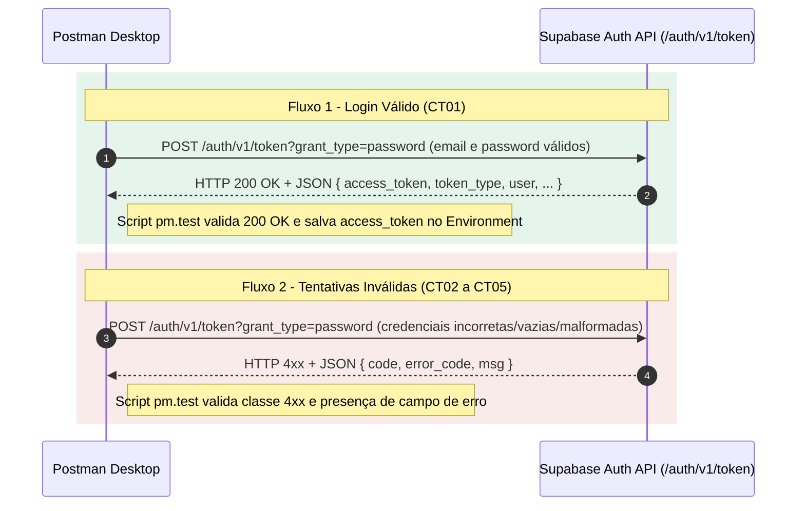

# Introdução

- **Nome:** Gustavo Brasil
- **RA:** 252212
- **Disciplina:** AS406TSN2 - UX/UI e Testes de Software
- **Repositório Público:** https://github.com/brasil1812/testes-caixa-cinza-supabase-gustavo-brasil

Nesta atividade prática individual, realizei uma bateria de testes de caixa cinza em uma API REST de autenticação fornecida pelo Supabase, utilizando o Postman Desktop no Windows (PowerShell) sem camada de interface gráfica (front-end). A proposta de trabalhar em caixa cinza consiste em testar os endpoints da aplicação tendo conhecimento prévio da arquitetura interna da comunicação — como o formato exigido pelo GoTrue/Supabase Auth na rota de concessão de token, cabeçalhos de autorização, variáveis de ambiente e estrutura esperada do payload JSON — enquanto valido o comportamento externo das respostas HTTP diante de entradas válidas e inválidas.

# Objetivo da Atividade

Meu objetivo nesta atividade foi configurar um serviço real de autenticação por e-mail e senha no Supabase e validar o endpoint de login via API (`POST /auth/v1/token?grant_type=password`) por meio de cinco cenários de teste estruturados no Postman. Em cada cenário, busquei inspecionar o código de status HTTP retornado, a estrutura do corpo JSON da resposta, a emissão e armazenamento do token JWT (`access_token`) em autenticações legítimas e o tratamento adequado de erros de validação e de credenciais incorretas quando os dados fogem do esperado.

# Configuração do Supabase

Para preparar o back-end dos testes, criei no Supabase o projeto **`auth-teste-gustavo-brasil`** na região Americas mantendo as configurações padrão do plano gratuito.

Em seguida, realizei os seguintes ajustes para viabilizar os testes diretos via API:
1. Acesse a seção **Authentication > Sign In / Providers**, confirmei que o provedor **Email** estava habilitado (`Enabled`) e desmarquei a opção **Confirm email**. Essa etapa é essencial porque, caso a confirmação por e-mail permaneça ativa, a tentativa de login mesmo com credenciais corretas é bloqueada com erro `400` (`error_code: "email_not_confirmed"`).
2. No menu **Authentication > Users**, cliquei em **Add user > Create new user** e cadastrei o usuário de teste com a opção **Auto Confirm User** marcada, garantindo que a conta já nascesse apta para autenticar.
3. Pelo painel **Connect** (e configurações de API do projeto), coletei a **Project URL** e a chave pública (**anon / publishable key**). Por questão de segurança e boas práticas de teste de cliente, utilizei apenas a chave pública, nunca expondo ou utilizando a chave `service_role`.

> **Observação sobre chaves do Supabase:** Caso o endpoint rejeite o header `Authorization: Bearer` com a nova chave no formato `sb_publishable_...`, utiliza-se a chave pública `anon` legada (formato JWT `eyJ...`) disponível nas configurações de API do projeto.

[INSERIR PRINT: prints/01-supabase-auth-config.png - Painel do projeto auth-teste-gustavo-brasil em Authentication > Sign In / Providers mostrando Email Enabled e Confirm email desmarcado]

[INSERIR PRINT: prints/02-supabase-usuario-criado.png - Tela Authentication > Users do projeto auth-teste-gustavo-brasil mostrando o usuário de teste cadastrado e confirmado]

# Configuração do Postman

No Postman Desktop, estruturei o ambiente de trabalho respeitando a nomenclatura padronizada da atividade:
- **Workspace:** `Teste Caixa Cinza - Gustavo Brasil`
- **Environment:** `Supabase - Gustavo Brasil`
- **Coleção:** `Auth API Tests - Gustavo Brasil`

Dentro do Environment **`Supabase - Gustavo Brasil`**, cadastrei as quatro variáveis utilizadas pelas requisições:
- `base_url`: URL base do projeto `auth-teste-gustavo-brasil` no Supabase.
- `api_key`: chave pública (`anon` / `publishable`) do projeto.
- `email`: endereço de e-mail do usuário válido cadastrado no Supabase.
- `password`: senha correspondente ao usuário de teste.

Além dessas quatro variáveis iniciais, o script de pós-resposta do cenário **CT01** cria e preenche dinamicamente a variável `access_token` no Environment assim que o login válido retorna o token JWT. Antes de exportar o arquivo `postman/environment.json` para este repositório, substituí todos os dados reais por `XXXXX` para não expor credenciais.

[INSERIR PRINT: prints/03-postman-workspace-environment.png - Postman Desktop mostrando o Workspace Teste Caixa Cinza - Gustavo Brasil, a coleção Auth API Tests - Gustavo Brasil e o Environment Supabase - Gustavo Brasil ativo com as variáveis base_url, api_key, email e password]

# Configuração das Requisições

Todas as cinco requisições da coleção **`Auth API Tests - Gustavo Brasil`** apontam para o endpoint de autenticação por senha do Supabase:

- **Método:** `POST`
- **URL:** `{{base_url}}/auth/v1/token?grant_type=password`

### Cabeçalhos (Headers)

| Header | Valor |
| :--- | :--- |
| `apikey` | `XXXXX` (`{{api_key}}`) |
| `Authorization` | `Bearer XXXXX` (`Bearer {{api_key}}`) |
| `Content-Type` | `application/json` |

### Exemplo de Body (raw / JSON)

```json
{
  "email": "{{email}}",
  "password": "{{password}}"
}
```

### Cenários Configurados na Coleção

1. **CT01 Requisição 1 – Login Válido:** utiliza `{{email}}` e `{{password}}` válidos do Environment. O script `pm.test` verifica o status HTTP `200`, confirma a presença da propriedade `access_token` no JSON e grava seu valor na variável `access_token`.
2. **CT02 Requisição 2 – Senha Incorreta:** mantém `{{email}}` válido e envia uma senha incorreta (`"SenhaErrada!999"`). O script valida o retorno de status na faixa `4xx` e a existência de campos de erro no JSON (`msg`, `error_code` ou `error_description`).
3. **CT03 Requisição 3 – Usuário Inexistente:** envia um e-mail com formato válido que não consta na base (`"naoexiste.gustavo.brasil@exemplo.com"`) junto com `{{password}}`. O script valida status `4xx` e estrutura de erro.
4. **CT04 Requisição 4 – Campos Vazios:** envia `email` e `password` como strings vazias (`""`). O script valida status `4xx` e resposta de erro de validação/autenticação.
5. **CT05 Requisição 5 – Credenciais Inválidas:** envia um e-mail malformado sem o caractere `@` (`"emailsemarroba.com"`) e uma senha curta (`"123"`). O script valida status `4xx` e presença de mensagem de erro.

# Execução dos Testes

Com o Environment **`Supabase - Gustavo Brasil`** selecionado no canto superior direito do Postman, executei inicialmente cada uma das cinco requisições de forma individual para inspecionar o código HTTP, o tempo de resposta, o corpo JSON retornado pela API e a aba **Test Results**. Em seguida, utilizei o **Collection Runner** para executar a coleção **`Auth API Tests - Gustavo Brasil`** de ponta a ponta e consolidar a verificação automatizada dos scripts.



### Evidências de Execução

[INSERIR PRINT: prints/04-ct01-login-valido.png - Execução do CT01 Requisição 1 – Login Válido exibindo status 200 OK, JSON com access_token e Test Results aprovados]

[INSERIR PRINT: prints/05-ct02-senha-incorreta.png - Execução do CT02 Requisição 2 – Senha Incorreta exibindo status 4xx e JSON com mensagem de erro]

[INSERIR PRINT: prints/06-ct03-usuario-inexistente.png - Execução do CT03 Requisição 3 – Usuário Inexistente exibindo status 4xx e JSON com mensagem de erro]

[INSERIR PRINT: prints/07-ct04-campos-vazios.png - Execução do CT04 Requisição 4 – Campos Vazios exibindo status 4xx e JSON com mensagem de erro]

[INSERIR PRINT: prints/08-ct05-credenciais-invalidas.png - Execução do CT05 Requisição 5 – Credenciais Inválidas exibindo status 4xx e JSON com mensagem de erro]

[INSERIR PRINT: prints/09-postman-collection-runner.png - Execução completa da coleção Auth API Tests - Gustavo Brasil no Collection Runner com os 5 cenários executados]

# Registro dos Testes

Os resultados colhidos durante a execução no Postman foram registrados tanto na tabela resumo abaixo quanto na planilha oficial do projeto localizada em `planilha/planilha-testes-caixa-cinza-gustavo-brasil.xlsx` (abas **Informações do projeto**, **Sistema** e **Aceitação**).

| Cenário | Entrada Utilizada | Resultado Esperado | Resultado Obtido | Status |
| :--- | :--- | :--- | :--- | :--- |
| **CT01 Requisição 1 – Login Válido** | `email`: `{{email}}` (válido)<br>`password`: `{{password}}` (correta) | Status HTTP `200 OK` e JSON contendo `access_token` válido | [PREENCHER APÓS EXECUTAR] | [PREENCHER APÓS EXECUTAR] |
| **CT02 Requisição 2 – Senha Incorreta** | `email`: `{{email}}` (válido)<br>`password`: `"SenhaErrada!999"` | Status HTTP `4xx` e JSON informando erro de autenticação | [PREENCHER APÓS EXECUTAR] | [PREENCHER APÓS EXECUTAR] |
| **CT03 Requisição 3 – Usuário Inexistente** | `email`: `"naoexiste.gustavo.brasil@exemplo.com"`<br>`password`: `{{password}}` | Status HTTP `4xx` e acesso negado com mensagem de erro | [PREENCHER APÓS EXECUTAR] | [PREENCHER APÓS EXECUTAR] |
| **CT04 Requisição 4 – Campos Vazios** | `email`: `""`<br>`password`: `""` | Status HTTP `4xx` e JSON indicando erro de validação/credenciais | [PREENCHER APÓS EXECUTAR] | [PREENCHER APÓS EXECUTAR] |
| **CT05 Requisição 5 – Credenciais Inválidas** | `email`: `"emailsemarroba.com"`<br>`password`: `"123"` | Status HTTP `4xx` e JSON contendo mensagem de erro | [PREENCHER APÓS EXECUTAR] | [PREENCHER APÓS EXECUTAR] |

[INSERIR PRINT: prints/10-planilha-preenchida.png - Planilha planilha-testes-caixa-cinza-gustavo-brasil.xlsx preenchida com os resultados obtidos nas abas Sistema e Aceitação]

# Resultados Obtidos

- **CT01 (Login Válido):** [PREENCHER APÓS EXECUTAR]
- **CT02 (Senha Incorreta):** [PREENCHER APÓS EXECUTAR]
- **CT03 (Usuário Inexistente):** [PREENCHER APÓS EXECUTAR]
- **CT04 (Campos Vazios):** [PREENCHER APÓS EXECUTAR]
- **CT05 (Credenciais Inválidas):** [PREENCHER APÓS EXECUTAR]
- **Análise geral do comportamento da API:** [PREENCHER APÓS EXECUTAR]

# Conclusão

- **Execução dos testes e funcionamento da autenticação:** [PREENCHER APÓS EXECUTAR]
- **Dificuldades encontradas:** [PREENCHER APÓS EXECUTAR]
- **Falhas ou comportamentos observados:** [PREENCHER APÓS EXECUTAR]
- **Sugestões de melhoria:** [PREENCHER APÓS EXECUTAR]
- **Importância dos testes de caixa cinza em APIs:** A aplicação de testes de caixa cinza diretamente na camada de API permite validar regras de negócio, contratos JSON, códigos de retorno HTTP e mecanismos de segurança sem depender de uma interface gráfica. Como conheço a estrutura interna esperada pelo serviço de autenticação (como cabeçalhos `apikey`/`Authorization`, parâmetros de `grant_type` e formato dos tokens JWT), consigo desenhar casos de teste muito mais precisos para verificar tanto o fluxo principal quanto situações de borda, garantindo que falhas de validação ou vazamentos de informação nas mensagens de erro sejam identificados antes mesmo de integrar o front-end.
